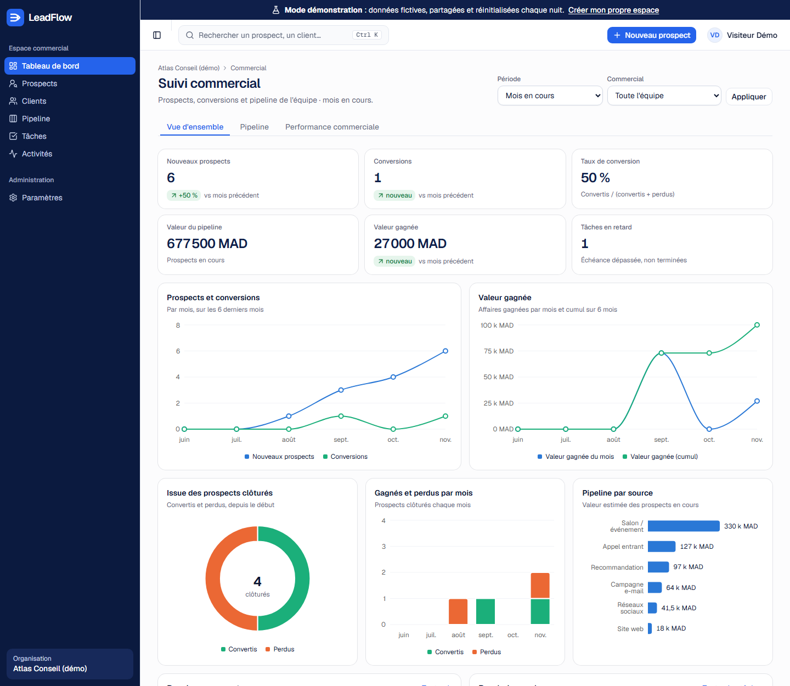
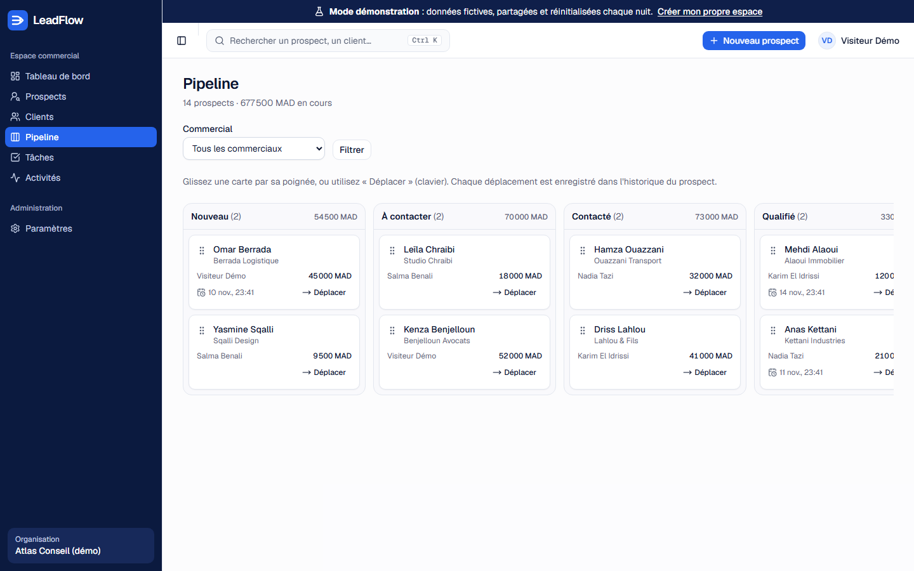
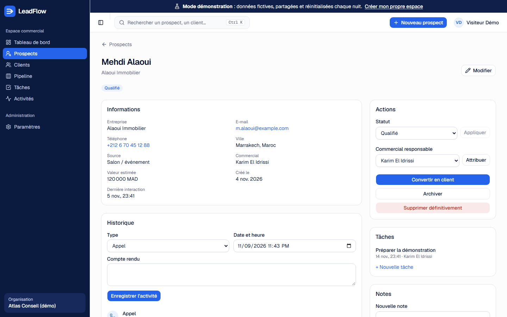
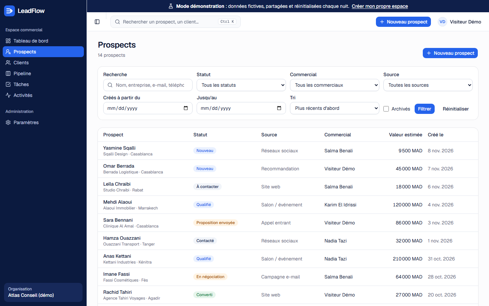
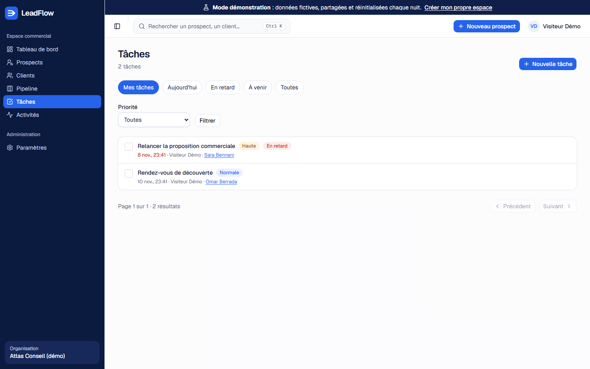
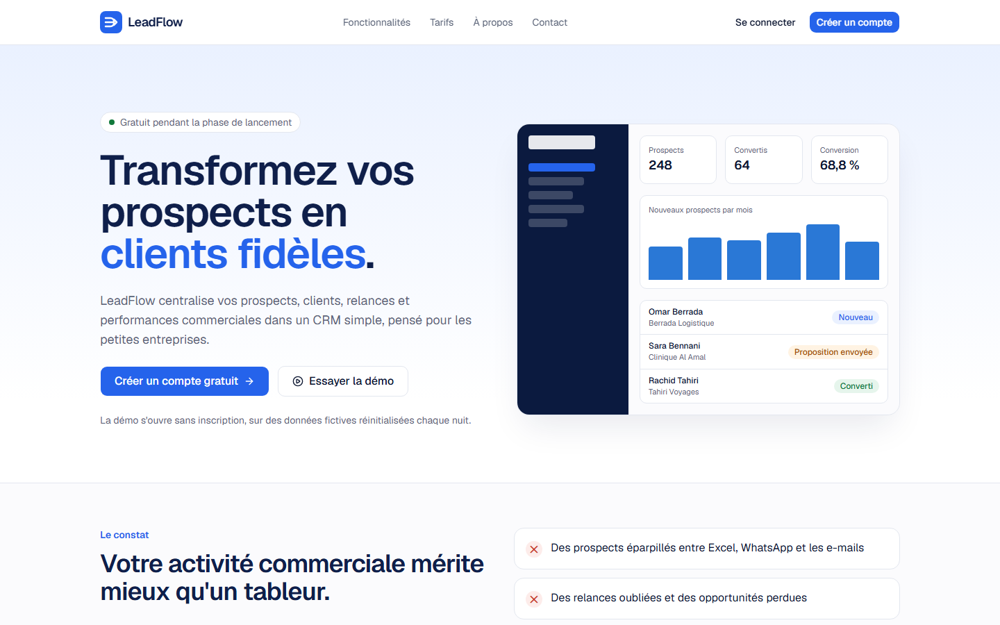
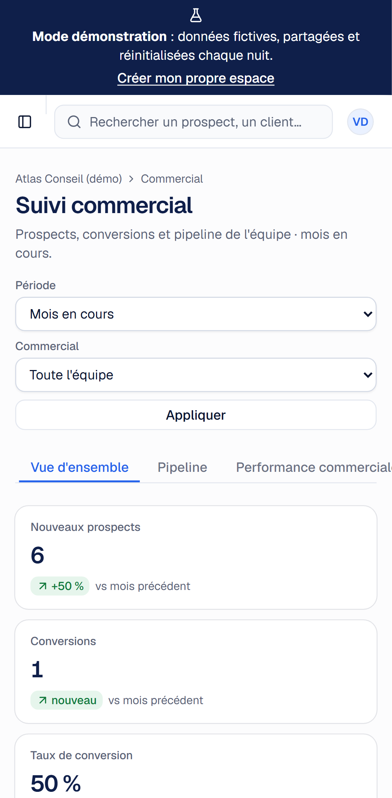
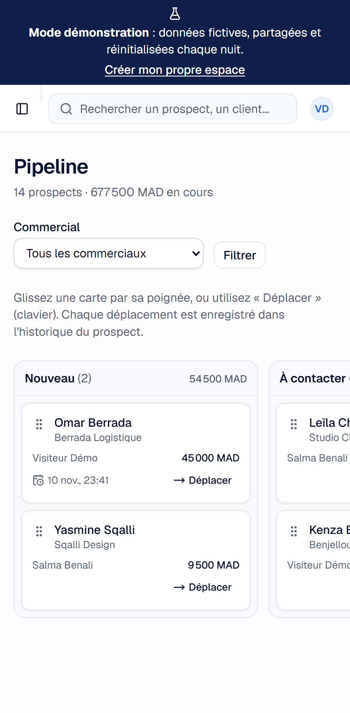
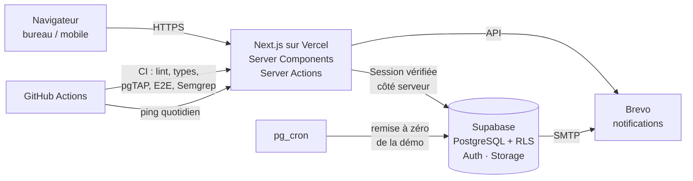

# LeadFlow — CRM SaaS multi-entreprise

**Le CRM simple et sécurisé des petites entreprises** : prospects, clients, pipeline commercial,
relances et tableau de bord, dans un espace isolé pour chaque entreprise.

### 👉 [Essayer la démo en direct](https://leadflow-seven-roan.vercel.app) — un clic, sans inscription

> Cliquez sur **« Essayer la démo »** : vous êtes connecté à une entreprise fictive avec ses
> prospects, ses clients et ses statistiques. Les données sont réinitialisées chaque nuit.

*English summary below.*

---

## Le problème

Dans beaucoup de petites entreprises, les prospects sont éparpillés entre Excel, WhatsApp et les
e-mails : des relances sont oubliées, des opportunités perdues, et personne n'a de vision claire
des performances commerciales. Les CRM du marché sont souvent trop chers ou trop complexes pour elles.

## La solution

| Fonctionnalité | Détail |
|---|---|
| **Prospects** | Fiche complète, statut, source, valeur estimée, commercial responsable, détection des doublons |
| **Pipeline** | Kanban par glisser-déposer (souris, tactile **et clavier**), mise à jour instantanée |
| **Conversion** | Un prospect devient client en un clic, avec son opportunité et son historique |
| **Relances** | Tâches avec priorité et échéance, alertes de retard |
| **Historique** | Appels, e-mails, rendez-vous, notes ; chaque changement de statut est tracé |
| **Tableau de bord** | Indicateurs du mois, évolution sur 6 mois, performance par commercial |
| **Équipe** | Trois rôles (Administrateur, Manager, Commercial), invitations par lien à usage unique |
| **Données** | Export CSV compatible Excel, journal d'audit des opérations sensibles |
| **Mobile** | Interface entièrement utilisable sur smartphone |

## Captures d'écran

| Pipeline commercial | Fiche prospect |
|---|---|
|  |  |

| Liste des prospects | Tâches et relances |
|---|---|
|  |  |

| Site vitrine | Mobile |
|---|---|
|  |   |

## Stack technique

| Couche | Technologies |
|---|---|
| Interface | **Next.js 16** (App Router, Server Components, Server Actions, Cache Components), **React 19**, **TypeScript** strict, **Tailwind CSS 4**, shadcn/ui, Recharts |
| Validation | **Zod 4**, schémas partagés entre navigateur et serveur |
| Données | **Supabase** : PostgreSQL 17, Auth, Storage ; **Row Level Security** sur toutes les tables |
| E-mails | Brevo (SMTP et API transactionnelle) |
| Tests | **pgTAP** (base de données), **Vitest** (unitaires), **Playwright** (bout en bout, bureau et mobile), axe-core (accessibilité) |
| Qualité et sécurité | ESLint, Semgrep (OWASP Top 10), OWASP ZAP, npm audit |
| Déploiement | **Vercel**, **GitHub Actions** (CI à chaque Pull Request), tâche planifiée quotidienne |

## Architecture

- **Multi-entreprise** : chaque ligne porte un `organization_id` ; l'isolation est garantie **par la
  base de données** (RLS), pas seulement par le code de l'application.
- **Logique métier dans PostgreSQL** quand elle doit être infalsifiable : conversion d'un prospect,
  historique des changements de statut, journal d'audit, limite d'envois du formulaire de contact.
- **Couche d'accès aux données** côté serveur : chaque page et chaque action vérifie la session
  et les droits avant de lire ou d'écrire.

## Sécurité

La sécurité a été pensée dès la conception (défense en profondeur), puis auditée :

- **Isolation des entreprises par RLS** : un utilisateur ne peut pas lire les données d'une autre
  organisation, même en appelant l'API directement. Vérifié par des tests pgTAP.
- **Rôles appliqués par la base** : un commercial ne modifie, ne déplace et ne convertit que ses
  propres prospects ; seul un administrateur gère l'équipe, exporte les données et consulte le
  journal d'audit ; une organisation garde toujours au moins un administrateur.
- **Aucun secret côté navigateur** ; la clé d'administration n'est utilisable que dans un module
  serveur isolé (test automatique : elle n'apparaît dans aucun fichier téléchargé).
- **En-têtes HTTP** : Content-Security-Policy, HSTS, COOP/CORP, X-Frame-Options.
- **Protection XSS, CSRF, injection** : échappement natif de React, Server Actions avec contrôle
  d'origine, requêtes paramétrées, protection contre l'injection de formules dans l'export CSV.
- **Fichiers** : stockage privé, URL signées, vérification du type réel des images (signature binaire).
- **Formulaire public** : validation serveur, champ piège anti-robots, limite d'envois appliquée par la base.
- **Démo partagée sécurisée** : connexion sans mot de passe générée côté serveur, actions sensibles
  bloquées dans la base, remise à zéro automatique chaque nuit.
- **Audit** : Semgrep (0 résultat), OWASP ZAP (aucune alerte élevée), npm audit (0 vulnérabilité en
  production), 9 scénarios d'attaque testés de bout en bout.

## Qualité

| Vérification | Résultat |
|---|---|
| Tests de la base de données (pgTAP : RLS, rôles, règles métier, stockage, démo) | **136** réussis |
| Tests unitaires (Vitest) | **86** réussis |
| Tests de bout en bout (Playwright, bureau + mobile) | **plus de 180** réussis |
| Accessibilité (axe-core, WCAG 2.1 AA) | 0 violation sur les pages testées |
| Intégration continue | Chaque Pull Request : lint, types, tests, compilation, Semgrep |

## Méthode de travail

Le projet a été mené en **9 phases**, chacune validée avant de passer à la suivante :
analyse et cahier des charges → initialisation → design → base de données → authentification →
modules CRM → intégration → audit de sécurité → déploiement.
Chaque évolution passe par une branche, une Pull Request et une CI au vert avant d'être mise en production.

## Code source

Le code de LeadFlow est **privé** (produit destiné à la commercialisation).
**Un accès en lecture peut être accordé sur demande** pour un recrutement ou une collaboration.

## À propos

Je suis **Jean de Dieu Riche Tchibouanga**, développeur freelance basé à **Casablanca**.

Technicien supérieur en maintenance industrielle de formation, je me suis reconverti dans la tech
grâce à une bourse de **BHN Academy (Allemagne)** en **ingénierie des données** et **ingénierie de
l'IA pour les développeurs**. LeadFlow est l'un des projets qui concrétisent cette reconversion :
un produit complet, de l'analyse du besoin jusqu'à la mise en production, avec une attention
particulière portée à la sécurité et aux tests.

Je suis ouvert aux missions freelance, aux opportunités d'emploi et aux collaborations.
🌐 **Portfolio** : [riche-tchibouanga.vercel.app](https://riche-tchibouanga.vercel.app)
📩 Contact : via le [formulaire du site](https://leadflow-seven-roan.vercel.app/contact).

---

## English summary

**LeadFlow** is a multi-tenant CRM SaaS for small businesses (leads, clients, drag-and-drop
pipeline, follow-up tasks, analytics dashboard, team roles).

- **[Live demo](https://leadflow-seven-roan.vercel.app)**: one click on *« Essayer la démo »*, no sign-up.
- **Stack**: Next.js 16, React 19, TypeScript, Tailwind CSS 4, Supabase (PostgreSQL, Row Level
  Security, Auth, Storage), Zod, Vercel, GitHub Actions.
- **Security by design**: tenant isolation enforced by the database (RLS), role rules in
  PostgreSQL, strict HTTP headers, audited with Semgrep and OWASP ZAP.
- **Tested**: 136 database tests (pgTAP), 86 unit tests (Vitest), 180+ end-to-end tests
  (Playwright, desktop and mobile), WCAG 2.1 AA accessibility checks.
- Built by **Jean de Dieu Riche Tchibouanga**, freelance developer in Casablanca, Morocco —
  career switcher from industrial maintenance to data & AI engineering (BHN Academy, Germany).
  Source code is private; read access available on request.
  Portfolio: https://riche-tchibouanga.vercel.app
